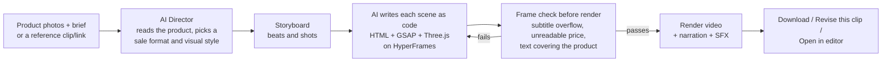

# SnapPromo

**Go live alone, with a whole AI crew.** SnapPromo helps small online shops turn product photos into sales videos and runs the on-screen graphics of a live stream in real time.

> A hackathon prototype for Track 2 · AI-Native Products & Operations.
> Every product, price and line of copy shown on the site is an illustrative sample.

For setup, the API, environment variables and the OBS connection, see [Technical reference](#technical-reference) at the end of this file.

---

## What it does

SnapPromo has three parts. All three share one account, and the data is stored in MongoDB.

| Part | Page | What the shop gets |
| --- | --- | --- |
| **Video Studio** | `/studio` | Add product photos (up to four PNGs) and a short brief, and get a sales clip back. The AI plans the shots, writes the script, picks a style, and adds narration, subtitles and sound effects. It checks frames before rendering. You can ask for changes to the same clip in plain language. |
| **Live Studio** | `/studio/live` | An assistant for live selling. Add your catalog and choose the shop's style. The AI writes the whole show script and designs the shop's motion kit. During the live, it watches the camera, listens to the host, and sends price tags, product cards and deals to OBS automatically. |
| **Editor** | `/editor` | Keep editing on a timeline: trim, split, add text and music. You can also edit with AI prompts. Exports MP4. |

### Video Studio flow



Video Studio has a second mode, **Hook Machine**. It learns how a shop's favourite clips speak: it fetches the clips, transcribes them and grades their hooks with a rubric. It then writes hooks and a script for a new product, and records Thai or English narration in several voice styles, scoring each take. Finally it assembles an MP4 with burned-in Thai captions.

### Live Studio flow

1. **Catalog**: add each product's CF code, name, price, a description of how it looks, and 1–3 reference photos. Detection uses this data.
2. **Style and lineup**: set the shop name, the host's tone, brand colours, the motion mood, and the order of products in the show.
3. **Prepare**: the AI writes the full show script (opening, a segment per product, interludes, closing, each with graphic cues). It also designs the shop's motion kit and makes short clips to play while the host takes a break.
4. **Control room**: connect OBS through a 1920 × 1080 Browser Source. During the live the system runs a loop:
   - **Watch**: detect which product the host is holding up, and box its position in the frame.
   - **Listen**: transcribe what the host says and turn it into intents such as price, discount, free gift or low stock.
   - **Decide**: pick the motion that fits the moment, and never show a product the camera has not actually seen.
   - **Show**: send transparent graphics to OBS at once. It can also zoom the camera onto the product through obs-websocket.

---

## Who it is for

**Primary users**: small online shops in Thailand, such as coffee, snacks, cosmetics, community products or crafts. These shops sell through short videos and live streams on platforms like Shopee or TikTok. They already have product photos, make their own content, and often go live alone.

**Their problems**

- They cannot afford a photographer, a scriptwriter and an editor.
- Templates make their clips look like every other shop's.
- Going live alone means talking, holding up products, reading comments and putting up price tags all at once.
- Every time a promotion changes, the clips and tags have to be made again.

**What SnapPromo does for them**

- **Before the live**: it turns product photos into sales clips with scenes designed for that product, not a reused template. Chili paste should feel warm and fragrant; serum should feel clean and trustworthy.
- **During the live**: it does the work of the crew behind the camera, the scriptwriter, the graphics operator and the person who puts up prices. The host keeps selling without stopping to press buttons.

---

## OpenAI in the product

At runtime the system calls the OpenAI API through [backend/src/services/openai.service.ts](backend/src/services/openai.service.ts). Environment variables can change the model for each task (see [OpenAI text generation](#openai-text-generation)).

| Task | API / default model | Code |
| --- | --- | --- |
| AI Director: brief, storyboard, and HyperFrames scenes written as code | Responses API · `gpt-6.2-astra` | [agent.service.ts](backend/src/services/agent.service.ts), [video/](backend/src/services/video/), [video-engine/](backend/integrations/video-engine/) |
| Generate and edit product images for scenes | Images API · `gpt-image-2.6-sunburst` | [video/production.ts](backend/src/services/video/production.ts) |
| Clip narration | `gpt-realtime-2.1` | [video/speech.ts](backend/src/services/video/speech.ts) |
| Hook Machine narration and take scoring | `gpt-4o-mini-tts`, `gpt-realtime-2.1-mini`, `gpt-audio-1.5` | [hook-machine/voice/](backend/src/services/hook-machine/voice/) |
| Transcription: reference clips, captions, and the host's speech during a live | `gpt-transcribe`, `gpt-4o-mini-transcribe` | [live/speech.ts](backend/src/services/live/speech.ts), [video/captions.ts](backend/src/services/video/captions.ts) |
| One live decision per second (product, held up or not, motion, risky claims) | Decisions API · `gpt-6-luna` | [live/director.ts](backend/src/services/live/director.ts) |
| Box the product's position in a live frame | Responses API · `gpt-6.2-sol` | [live/locate.ts](backend/src/services/live/locate.ts) |
| Design the shop's motion kit (AI Motion Designer) | Structured output | [live/motions.ts](backend/src/services/live/motions.ts) |

Safety limits: the Studio AI gets video production tools only. It never receives shell, filesystem, browser automation or OBS control tools. Scene preparation and frame checks run in a network-isolated Docker container per job.

---

## How we used OpenAI Codex

The team used **Codex Desktop** while shaping the idea and prototyping. The product also reads skills installed for Codex at runtime.

### 1. Ideation and simulated judging

- Read the hackathon brief and helped choose Track 2 · AI-Native Products & Operations.
- Developed the idea from a "live order summary assistant" into "every product gets its own content team", which became SnapPromo.
- Simulated the judges scoring each criterion (such as Real-World Value and Build Quality) and used the results to adjust the product flow.
- Researched public skills for product video, Blender and motion graphics, and grouped them by visual approach to find where the team should build its own. The conclusion: variety of styles can come from outside sources; what the team must build is choosing the style that fits what the shop wants to sell, and revising from previous work.
- Studied sales speaking and sales-video scriptwriting to guide how the AI writes scripts.

### 2. Live product detection prototype (the hardest part)

Codex built a separate demo in a `demo/` folder (since removed from the repository). It split the work across four subagents running in parallel:

| Subagent | Work |
| --- | --- |
| `fashion` | Tested look-alike clothing, benchmarked box models, and composited test images onto real room photos with ground-truth boxes |
| `kitchen` | Added localization (`locate`) and a per-frame streaming endpoint, with tests |
| `audit` | Tested the Detect page in Chrome with still images and video seeking |
| `review` | Reviewed the code and found bugs in the frame and reporting flow |

What came out of the demo:

- Catalog and Detect pages that use the OpenAI Decisions API to tell which product is in a frame, with a probability per product and whether the host is holding it up.
- An eval comparing "image only" with "image + text". **Choice + image only** was the most accurate.
- Several simulated shops (clothing, kitchenware, drinking glasses and more) and test images with varied positions and backgrounds.
- A benchmark of box models, and a method that places the frame inside 0–1000 rulers so the model reads edges itself, with `null` as a valid answer when the product is absent. The code records that `gpt-6.2-sol` won the benchmark with 10/12 boxes at IoU ≥ 0.5, no false boxes in 6 absent-product cases, and a 3.0 s mean.
- Pitch advice: let the judges pick the product or change the price in the middle of the live themselves.

The demo's method was then moved into the product in [live/locate.ts](backend/src/services/live/locate.ts) and [frontend/lib/live-detect.ts](frontend/lib/live-detect.ts).

### 3. Codex skills used at runtime

The video engine looks for `SKILL.md` in this order: `VIDEO_SKILLS_DIR` → `~/.agents/skills` → **`~/.codex/skills`** → [backend/integrations/video-skills/](backend/integrations/video-skills/) ([runtime.mjs](backend/integrations/video-engine/runtime.mjs)). Skills installed for Codex (such as the `hyperframes-*` set) therefore also serve as guides the AI Director reads while designing scenes.

### 4. The "Codex codes the scene" idea

The core of the product is that the AI does not fill in a template. It writes a new motion graphic as HTML, GSAP and Three.js code for each product, checks the frames before rendering, and fixes failures itself before delivery. In the product this step runs through the OpenAI Responses API (`gpt-6.2-astra`) on HyperFrames.

---

## What we built on, and what we built

### External foundations

| Source | Used for | License / notes |
| --- | --- | --- |
| [HyperFrames](https://www.npmjs.com/package/hyperframes) `0.9.75` + the `hyperframes-*` skills | Video as HTML and its renderer, the Editor player, the SFX library | Skills are read from `~/.agents/skills` or `~/.codex/skills` |
| [Lemo-Opuscar](https://github.com/lemomo-ai/lemo-opuscar/tree/e3cb16f63768c68693ff0e15171d6e755457cc32) | 43 film styles (ukiyo-e, pixel RPG, art deco and more) for the AI Director to choose from | MIT, bundled in [video-skills/lemo-styles](backend/integrations/video-skills/lemo-styles/) |
| [OneTake](https://github.com/feitangyuan/onetake) | Optional single-camera continuous-take guide | Noncommercial use only; not bundled |
| [FilmCraft](https://github.com/storytold/filmcraft) | Editor timeline semantics (split, trim, ripple delete, undo/redo) | MIT; adapted to TypeScript by the team, Rust engine not embedded ([docs/filmcraft.md](frontend/docs/filmcraft.md)) |
| `apple-design` skill | Editor UI and motion design guidance | Supplied by the user ([apple-design.md](frontend/docs/design/apple-design.md)) |
| Agent Reach `1.6.1` + yt-dlp | Reading public web pages, links and reference clips | Sends to Jina Reader only the URLs the user provides |
| GSAP, Three.js, Blender (local bridge), FFmpeg | Animation, 3D and video encoding | |
| obs-websocket v5 | Zooming the OBS camera onto the product | |
| Next.js 16, React 19, shadcn/Radix, Tailwind 4 | Frontend | |
| Express 5, LangGraph, MongoDB/Mongoose, Zod | Backend: stateful agent runs, storage, input validation | |

Public skills studied for ideas only, with no code reused: [ecommerce-video-skills](https://github.com/xianyu110/ecommerce-video-skills), [vargHQ product-photo-to-video](https://github.com/vargHQ/skills/blob/main/product-photo-to-video/SKILL.md).

### Built by the team

- **Video Studio AI Director**: brief → storyboard → parallel scene designs → frame and continuity checks → render, plus revising an existing clip through its `projectId`.
- **16 sale formats** ([sale-formats.ts](backend/src/services/video/sale-formats.ts)): showcase, promotion, flash sale, new launch, bundle, before/after, how-to, comparison, review and more. Each is a beat skeleton the AI follows. Facts come only from the brief; the AI never invents prices or claims.
- **Hook Machine**: learns speaking style from reference clips, grades hooks with a rubric, fits the script to the voice length, scores voice takes, and composes the clip with Thai captions ([hook-machine/](backend/src/services/hook-machine/), [compose/](backend/src/services/compose/)).
- **Live Director**: the show script, the shop's motion kit, per-second decisions, product boxing, and speech transcription with intent detection ([live/](backend/src/services/live/)).
- **Overlay graphics library**: 156 graphics / 611 presets on seek-safe GSAP timelines, the `LiveCut` event format, paper/ink/pop themes, face-box avoidance, a data-only `compose` graphic that lets the AI design new motion without code changes, and SFX ([public/overlay/](backend/public/overlay/)).
- **Editor** in the browser, saved to the account, with MP4 export in Docker.
- Accounts and sessions, owner-scoped data, the render sandbox, and backend (Jest) and frontend (node:test, Playwright) tests.
- The backend skeleton (Express + TypeScript) comes from an earlier team project, with its prefix renamed from `af` to `so`.

---

## Quick start

You need Node.js 22, MongoDB, Docker, FFmpeg and Chrome.

```sh
# backend (port 8080)
cd backend
npm ci
# create backend/.env.development with OPENAI_API_KEY, MONGODB_URI and APP_ORIGINS=http://localhost:3000
npm run dev

# build the render sandbox once, from the repository root
docker build -t sea-video-sandbox:0.9.75 backend/integrations/video-sandbox

# frontend (port 3000)
cd frontend
npm ci
npm run dev
```

Open http://localhost:3000, create an account at `/register`, then go to `/studio` or `/studio/live`.

Full details (endpoints, the OBS overlay and its events, the Blender bridge, Agent Reach, tests) are in [Technical reference](#technical-reference) below.

## Repository layout

```text
backend/    Express + TypeScript API, AI director, live director, overlay and rendering
  integrations/video-engine/   HyperFrames scene-writing engine
  integrations/video-skills/   bundled style guides (Lemo-Opuscar)
  public/overlay/              OBS overlay page and graphics library
frontend/   Next.js: landing page, Video Studio, Live Studio, Editor
```

---

## Technical reference

### Backend

The main API lives in `backend/` and uses Express and TypeScript. Use Node.js 22.

```sh
cd backend
npm ci
npm run dev
```

The development server defaults to port 8080. Set `PORT` when starting the server to override it.

Create `backend/.env.development` for local configuration. Git ignores environment files. To allow requests from the local frontend, set `APP_ORIGINS=http://localhost:3000,http://127.0.0.1:3000` in that file.

The backend writes logs to the console. Set `ACTIVITY_LOG_ENABLED=false` to turn off activity logging.

| Endpoint | Purpose |
| --- | --- |
| `GET http://localhost:8080/` | Service name and version |
| `GET http://localhost:8080/health` | Liveness check |
| `GET http://localhost:8080/agent/skills` | List installed skills |
| `POST http://localhost:8080/agent/chat` | Run a stateless agent turn |
| `POST /agent/threads` | Start a saved thread and stream the first turn |
| `GET /agent/threads/:id` | Read the saved conversation and run status |
| `POST /agent/threads/:id/messages` | Continue a saved conversation |
| `POST /agent/threads/:id/resume` | Resume an interrupted turn |
| `GET http://localhost:8080/__openapi.json` | OpenAPI document |

To run the compiled server, run `npm run build` followed by `npm start` from `backend/`. With `NODE_ENV=production`, set `APP_ORIGINS` to a comma-separated list of allowed origins in the environment or in `backend/.env.production`.

#### Account and session

Open `http://localhost:3000/register` to create an account or `/login` to sign in. Studio requires a session. The frontend forwards `/auth/*` and `/agent/*` to the backend; configure `BACKEND_ORIGIN` before building the frontend if the backend uses another address.

| Endpoint | Purpose |
| --- | --- |
| `POST /auth/register` | Create an account with an email and a password of 12–128 characters, and sign in. |
| `POST /auth/login` | Start a new session for the account. |
| `GET /auth/me` | Read the signed-in user's ID and email. |
| `POST /auth/logout` | Revoke the current session and clear its cookie. |

For MongoDB Atlas, set `MONGODB_URI` to the cluster’s authenticated `mongodb+srv://` connection string in the ignored `backend/.env.development` file and set `MONGODB_DB=sea_openai`. Allow the backend’s outbound IP in Atlas Network Access and restart the backend. Mongoose and LangGraph share this connection. It stores accounts in `users` and session token hashes in `auth_sessions`. Sessions expire after seven days. Production requires HTTPS for the HttpOnly session cookie. For CLI access, log in using a temporary cookie jar and reuse it in agent requests.

```sh
cookie_jar=$(mktemp)
curl -s -c "$cookie_jar" http://localhost:8080/auth/login \
  -H 'Content-Type: application/json' \
  -d '{"email":"you@example.com","password":"<your password>"}'
curl -s -b "$cookie_jar" http://localhost:8080/auth/me
```

#### OpenAI text generation

Set `OPENAI_API_KEY` in your environment or in `backend/.env.development` for local development. The default model is `gpt-6.2-astra`. Set `OPENAI_MODEL` to select the model used by the agent and text service, or pass `model` when calling `generateText()`. The video agent uses `gpt-image-2.6-sunburst` for images and `gpt-realtime-2.1` for narration. To change those defaults, set `OPENAI_IMAGE_MODEL` or `OPENAI_SPEECH_MODEL` in the same environment.

```ts
import { generateText } from '@/services/openai.service.js'

const reply = await generateText('Explain TypeScript', {
  instructions: 'Reply in Thai in one sentence.',
})
```

To try the service directly from `backend/` after setting the API key, run:

```sh
node --import tsx --input-type=module -e 'import "./src/env.ts"; import { generateText } from "./src/services/openai.service.ts"; console.log(await generateText("Say hello in Thai."))'
```

#### Video Studio

Editor timelines and media persist under the authenticated user in the MongoDB collections `editor_projects` and `editor_media_chunks`. The editor compiles the timeline into a HyperFrames composition. The player previews that composition, and Export MP4 validates the saved revision in Docker and renders it on the backend host at 30 fps.

Sign in at `http://localhost:3000/studio`, enter a video brief and generate a clip. The agent selects a matching style from the built-in catalog and your personal styles for each brief. Video Studio (`/studio`) produces a 720 × 1280 portrait WebM at 30 fps. Drop up to four product PNGs, add an optional reference clip, or describe a motion graphic. The director plans beats, runs independent scene designs in parallel, and checks rendered frames. Specify a shot count, duration and on-screen copy in the brief. For footage-free motion ask for “HyperFrames motion only”. After playback select **Revise this clip** to edit the same production. The API returns its `projectId`. MongoDB stores the owner's editable source in `video_sources` (GridFS) and the current revision in `video_productions`.

For continuous motion, describe the hero, the camera path and the beats it passes through. The agent can use one HyperFrames timeline for the take and carry the beat positions into the editor. The renderer checks adjacent frames in the delivered file for timing gaps and abrupt changes. A new continuous film gets one redesign attempt if the check finds a jump. Explicit montages can use separate compositions.

The director can select an art direction from 43 bundled Lemo-Opuscar styles. The checked-in guides come from [the MIT-licensed revision](https://github.com/lemomo-ai/lemo-opuscar/tree/e3cb16f63768c68693ff0e15171d6e755457cc32). The single-camera workflow also accepts a locally installed OneTake guide at `$VIDEO_SKILLS_DIR/onetake/SKILL.md`. Its [upstream license](https://github.com/feitangyuan/onetake/blob/main/LICENSE) covers noncommercial use. Configure that directory for projects covered by your license. The built-in camera and frame checks work independently.

For Studio films the agent selects recorded effects from the installed HyperFrames sound library and times them to actions on screen. The project archive includes the selected audio files and their credits. Ask for sound effects only to omit music and narration, or request a silent film to omit all three.

The backend runs HyperFrames scene preparation and frame checks in a disposable, network-isolated Docker container per job. A host-side HyperFrames process renders the final WebM. Build the sandbox once from the repository root with `docker build -t sea-video-sandbox:0.9.75 backend/integrations/video-sandbox`. The host needs Docker, FFmpeg and a Chrome installation visible to HyperFrames. Run `npx hyperframes doctor` in `backend/` to check the renderer.

`GET /agent/skills` returns the enabled video tools. Film production supports OpenAI images and narration, scene editing and review, uploaded media, registry blocks, Three.js, stock photos and licensed music. AI footage, video restyling, avatars and lip-sync require an additional video provider. Custom Blender scene design requires a paired scene bridge. Live Studio (`/studio/live`) creates silent, three-second transparent overlays from up to one product image and includes the OBS controls. For 3D it renders a rotating box, cylinder or torus with the local Blender application.

The agent accepts video and live-graphics briefs and receives only video production tools. Out-of-scope requests receive a fixed reply. Motion directions from a skill or reference supply design input. Chat, saved threads and resumed runs use the same policy. OpenAI does not receive shell, browser automation, filesystem or OBS control tools.

**Skills.** The built-in catalog includes `motion-graphics`, `hyperframes-animation`, `explainer-default`, `explainer-engaging`, `explainer-high-energy`, `motion-broll` and `blender-3d`. The backend reads the matching style guide from `~/.agents/skills` on the host or `VIDEO_SKILLS_DIR`, with bundled guidance for machines without the guide. Blender uses the HyperFrames 3D guide. API clients can also request a specific style using the `skill` field or its slash command.

**Personal styles.** In Studio choose “Add a personal style” and upload a Markdown file like the example below. Each account can save 20 styles. Names must be unique within the account. The upload endpoint is `POST /agent/skills` with a JSON `markdown` string. MongoDB stores personal instructions in `video_skills`.

```md
---
name: neon-reveal
description: A violet product reveal for live promotions
---
Keep the title short. Use a violet accent and pulse once on the reveal.
```

**References.** Studio accepts a public HTTPS reference URL or an uploaded MP4/WebM clip up to 8 MiB and five minutes. For clips the designer sees three sampled frames in time order. For webpages it receives text. Some video platforms expose only a title and description. Direct MP4/WebM links can provide frames. An unreadable reference returns an error. Private uploads and outputs in `agent_files` are available to their owner.

Agent Reach 1.6.1 runs from a project-specific Python environment. Its reader sends public page URLs to Jina Reader. Only the explicit URL of an accepted video request reaches that reader. The backend can also read public HTML and YouTube metadata. For a fresh checkout install the pinned dependency once from `backend/`:

```sh
uv venv --python 3.12 integrations/agent-reach/.venv
uv pip install --python integrations/agent-reach/.venv/bin/python -r integrations/agent-reach/requirements.txt
```

**Local Blender.** On this Mac the Blender 5.3 user startup folder links to `backend/blender/sea_video.py`. Open Blender normally, then refresh Studio to see its status. For another Mac, place the bridge in `~/Library/Application Support/Blender/<version>/scripts/startup/` and launch Blender. The bridge uses Blender's Python API and a private local job directory. It accepts a shape and a color and renders in a temporary scene.

**Saved threads.** `POST /agent/threads` streams plan, step and result events. Use the returned thread ID with `/messages` or `/resume`. LangGraph persists the video plan and shot design between steps. Without a configured URI, Mongoose connects to `mongodb://127.0.0.1:27017` and defaults to database `sea_openai`. Override these with `MONGODB_URI` and `MONGODB_DB`. Conversations live in `agent_threads`, and the checkpointer uses `checkpoints` and `checkpoint_writes`.

```sh
curl -s -b "$cookie_jar" http://localhost:8080/agent/chat \
  -H 'Content-Type: application/json' \
  -d '{"message":"Make a promo tag clip for 299 baht on a transparent background"}'
```

The response includes an owner-authenticated download URL in `files`. The API fields `referenceUrl` and `referenceFile` accept a public URL and the ID of an uploaded reference clip respectively. Upload bytes to `POST /agent/files?name=example.webm` as `application/octet-stream`.

#### OBS overlay

1. In Studio generate an OBS link. In OBS add a **Browser Source**, paste the complete link and set the source size to 1920 × 1080.
2. Wait for **Overlay connected** in Live Studio. If the first Browser Source was created by automation and stays blank, keep the source in the scene collection and reopen OBS with that collection. The existing overlay URL remains valid.
3. Enter a SKU and price in Studio and press **Test price overlay**. Use **Play clip on overlay** to play a generated WebM. The read-only link belongs to the signed-in account. Generating another link disconnects previous viewers.
4. An integration can send the following events to `POST /agent/overlay/events` with the owner's session. The response includes the number of subscribed pages that received the event.

| Event | Payload example |
| --- | --- |
| Live price | `{"type":"price","sku":"A1","price":299}` |
| Product | `{"type":"product","name":"Iced coffee"}` |
| Ingredients | `{"type":"ingredients","text":"Coffee · fresh milk"}` |
| Sales total | `{"type":"sales","total":4200}` |
| Preloaded transparent WebM | `{"type":"promo"}`, `gift`, `flash`, `transition` |
| Generated WebM | `{"type":"clip","fileId":"<returned file ID>"}` |

Live price, product and ingredients events also accept an optional `image` as a PNG/JPEG data URL up to 180,000 characters. The overlay preloads the timeline library and static clips, then connects to the backend at `/overlay/ws`. The two playback slots rebuild prebuilt HyperFrames motion templates (per-type accent, sweep, count-up for price and sales) with the incoming values, so events show instantly. A third event replaces the oldest active slot. Malformed events return 400; slow clip loads show the default live badge. Events do not wait for a model call or replay when a source reconnects. For non-urgent price, product, ingredients or sales graphics, `POST /agent/overlay/motion` returns 202 and designs a fresh transparent HyperFrames motion in the background (one job per account); the finished clip plays on connected overlays automatically and `GET /agent/overlay/status` reports `rendering` meanwhile. Live Studio overlays without 3D are also designed and rendered with HyperFrames.

Overlay graphics are prebuilt templates that show instantly. Price, product, ingredients, sales and the `promo`, `gift`, `flash` and `transition` presets accept an optional `style`: `tag` (paper hang-tag), `sticker`, `receipt` or `flap` (split-flap board). Presets default to `sticker`, `tag`, `flap` and `receipt`.

A `spotlight` event pops a product card out of a point in the 1920 × 1080 frame, such as the host's fingertip when they name the product:

```json
{ "type": "spotlight", "x": 0.66, "y": 0.5, "image": "data:image/png;base64,…", "name": "Daily Glow perfume", "price": 1590, "motion": "pop", "box": { "x": 0.56, "y": 0.5, "w": 0.2, "h": 0.32 } }
```

`x`, `y` and `box` are fractions of the frame. `motion` is `pop` (card on a leader line, default), `bubble`, `rise` or `flip`. The optional `box` draws corner brackets around an area. The card opens below the point when it is in the top 42 % of the frame and stays inside the frame horizontally. The OpenAI Decisions API returns probabilities and choices, not coordinates, so a caller can ask a `choice` question over a grid of frame cells and send the chosen cell as `box` and its top centre as `x`, `y`.

**Graphics library.** `backend/public/overlay/graphics/` holds a registry of seek-safe GSAP graphics. Send `{ "type": "graphic", "preset": "<id>", "data": { … }, "x", "y", "box", "image", "theme", "ttl" }`. Every graphic has `paper`, `ink` and `pop` presets (`price-pop`, `price-pop-ink`, `price-pop-pop`) plus copy variants. Groups: LiveCut, hand and spotlight, price and deals, shopping urgency, broadcast, streamer alerts, news, sports and education, lifestyle and events. `compose` builds a graphic from data alone: text, panel, image, number, line, dot and ring layers placed in % of the frame, with named entrance, hold and exit recipes, so a director can create new motion without shipping code.

**LiveCut events.** The overlay also accepts the LiveCut director format `{ "type": "price_pop|price_drop|free_badge|low_stock|product_card|cf_toast|combo|fireworks|poll|caption|crawl|glow|face_box|theme|jump_zoom|zoom|zoom_out", "payload": { … }, "ttl": 2000 }`. Graphics enter in 0.2–0.3 s and hold for `ttl`. A `face_box` (frame fractions) moves lower-thirds, corner widgets, toasts and the product card to the side away from the face. `theme` sets the shop's `accent`, `accent2` and `font`, which can also be passed in the Browser Source URL.

**Camera zoom.** `zoom` with a `box` (or `x`, `y`) scales the camera source in OBS through obs-websocket v5 so the product sits in the centre, without exposing the canvas edge, and zooms back after `ttl` or on `zoom_out`. Enable OBS → Tools → WebSocket Server Settings and add `?camera=<camera source name>&obsPassword=<password>` to the Browser Source URL (optional `obs=ws://127.0.0.1:4455`, `scene=`, `maxZoom=2.5`). Serve the overlay from the same machine as OBS: newer Chromium builds block pages on public origins from opening local WebSockets. Without a connection the overlay frames the product and dims the rest instead. Use a single backend instance for local live delivery. For a different deployment origin, set `OVERLAY_PUBLIC_ORIGIN` on the frontend to the browser-accessible backend and forward WebSocket upgrades.

Run `npm run test:agent-mongo` from `backend/` for the restart, ownership and render checks. Set `TEST_OVERLAY_BROWSER=1` to also exercise real Chromium playback, timeline advancement, fallback, the slot limit and overlay link rotation. These tests use an isolated database and a mock OpenAI provider. To verify native rendering, start a separate OBS test instance with a Browser Source already in its scene collection and obs-websocket enabled. Set `TEST_OBS_URL` and `TEST_OBS_PASSWORD` for the same test command. The test temporarily adds a Browser Source to the active scene, publishes A1 at ฿299, captures its pixels and checks that it clears. Set `TEST_OBS_SCREENSHOT` to retain the PNG.

#### Backend structure

The main backend already includes this structure for adding new API features.

```text
backend/
├── src/
│   ├── server.ts      # Server startup and graceful shutdown
│   ├── app.ts         # Express app and middleware registration
│   ├── env.ts         # Environment variable loading
│   ├── config/        # Server, service, and CORS configuration
│   ├── constants/     # Shared constants and error codes
│   ├── routes/        # Route definitions
│   ├── controllers/   # HTTP request handlers
│   ├── schemas/       # Request validation
│   ├── services/      # Application logic and logging
│   ├── middlewares/   # Logging, error handling, and reusable rate limiting
│   ├── docs/          # OpenAPI generation and endpoint annotations
│   ├── models/        # MongoDB thread and checkpoint storage
│   ├── types/         # Placeholder for shared type declarations
│   └── utils/         # Shared helpers
├── skills/           # Agent skill instructions and references
├── sql/              # Placeholder for SQL files
└── tests/            # API and middleware tests
```
