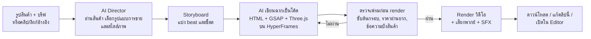

# SnapPromo

**ไลฟ์คนเดียว แต่มีทีม AI ทั้งทีม**: ระบบช่วยร้านค้าออนไลน์ขนาดเล็กทำวิดีโอขายของจากรูปสินค้า และคุมกราฟิกบนจอไลฟ์แบบเรียลไทม์

> โปรโตไทป์สำหรับ Hackathon, Track 2 · AI-Native Products & Operations
> สินค้า ราคา และข้อความตัวอย่างในหน้าเว็บเป็นข้อมูลจำลองทั้งหมด

ขั้นตอนติดตั้ง, API, ตัวแปร environment และการต่อ OBS อยู่ในหัวข้อ [Technical reference](#technical-reference) ท้ายไฟล์นี้

---

## ระบบนี้ทำอะไร

SnapPromo มี 3 ส่วนหลัก ทุกส่วนใช้บัญชีผู้ใช้เดียวกัน และเก็บข้อมูลไว้ใน MongoDB

| ส่วน | หน้า | ร้านค้าได้อะไร |
| --- | --- | --- |
| **Video Studio** | `/studio` | ใส่รูปสินค้า (PNG สูงสุด 4 รูป) กับบรีฟสั้น ๆ แล้วได้คลิปขายของ AI วางช็อต เขียนบท เลือกสไตล์ ทำเสียงพากย์ ซับ และเสียงประกอบ จากนั้นตรวจเฟรมก่อน render สั่งแก้คลิปเดิมเป็นภาษาคนได้ |
| **Live Studio** | `/studio/live` | ผู้ช่วยตอนไลฟ์: ใส่คลังสินค้า เลือกสไตล์ร้าน ให้ AI เขียนสคริปต์ทั้งไลฟ์และออกแบบชุด motion ประจำร้าน พอเริ่มไลฟ์ ระบบดูภาพจากกล้อง ฟังสิ่งที่แม่ค้าพูด แล้วส่งป้ายราคา การ์ดสินค้า หรือดีลขึ้นจอ OBS เอง |
| **Editor** | `/editor` | ตัดต่อคลิปต่อบนไทม์ไลน์ (ตัด แยก ใส่ข้อความ ใส่เพลง) สั่งแก้ด้วย AI ได้ แล้ว export เป็น MP4 |

### Flow ของ Video Studio



Video Studio มีโหมดที่สองชื่อ **Hook Machine** โหมดนี้เรียนรู้วิธีพูดจากคลิปที่ร้านชอบ (ดึงคลิป ถอดเสียง แล้ววิเคราะห์ hook ตาม rubric) จากนั้นเขียน hook และบทให้สินค้าใหม่ ทำเสียงพากย์ไทยหรืออังกฤษหลายสไตล์พร้อมให้คะแนนแต่ละเทค แล้วประกอบเป็น MP4 ที่มีซับไทยฝังในภาพ

### Flow ของ Live Studio

1. **คลังสินค้า**: ใส่รหัส CF ชื่อ ราคา คำอธิบายรูปลักษณ์ และรูปอ้างอิง 1–3 รูป ระบบจับสินค้าใช้ข้อมูลชุดนี้
2. **สไตล์และลำดับไลฟ์**: ชื่อร้าน น้ำเสียงแม่ค้า สีแบรนด์ อารมณ์ของ motion และลำดับสินค้าที่จะขาย
3. **เตรียมก่อนไลฟ์**: AI เขียนสคริปต์ทั้งไลฟ์ (ช่วงเปิด ช่วงขายแต่ละชิ้น ช่วงคั่น ช่วงปิด พร้อมคิวกราฟิก) ออกแบบชุด motion ของร้าน และทำคลิปสั้นไว้เปิดตอนแม่ค้าพัก
4. **ห้องควบคุม**: ต่อ OBS ผ่าน Browser Source ขนาด 1920 × 1080 ระหว่างไลฟ์ ระบบทำงานเป็นวงรอบ
   - **ดู**: จับว่าแม่ค้ายกสินค้าชิ้นไหนขึ้นมา และตีกรอบตำแหน่งสินค้าในภาพ
   - **ฟัง**: ถอดเสียงสิ่งที่แม่ค้าพูด แล้วแปลงเป็นเจตนา เช่น บอกราคา ลดราคา ของแถม ใกล้หมด
   - **ตัดสินใจ**: เลือก motion ที่เหมาะกับจังหวะนั้น และไม่แสดงสินค้าที่กล้องไม่ได้เห็นจริง
   - **ขึ้นจอ**: ส่งกราฟิกโปร่งใสเข้า OBS ทันที และซูมกล้องไปที่สินค้าผ่าน obs-websocket ได้

---

## ทำเพื่อใคร

**กลุ่มเป้าหมายหลัก**: ร้านค้าออนไลน์ขนาดเล็กในไทย เช่น ร้านกาแฟ ขนม เครื่องสำอาง สินค้าชุมชน หรืองานคราฟต์ ที่ขายผ่านวิดีโอสั้นและไลฟ์บนแพลตฟอร์มอย่าง Shopee หรือ TikTok ร้านกลุ่มนี้มีรูปสินค้าอยู่แล้ว แต่ทำคอนเทนต์เองและมักไลฟ์คนเดียว

**ปัญหาที่ร้านเจอ**

- จ้างช่างภาพ คนเขียนบท และคนตัดต่อไม่ไหว
- ถ้าใช้ template คลิปจะหน้าตาเหมือนร้านอื่น
- ตอนไลฟ์คนเดียว ต้องพูด ยกของ อ่านคอมเมนต์ และขึ้นป้ายราคาพร้อมกัน
- พอโปรเปลี่ยน ต้องทำคลิปและป้ายใหม่ทั้งหมด

**สิ่งที่ SnapPromo ทำแทน**

- **ก่อนไลฟ์**: เปลี่ยนรูปสินค้าเป็นคลิปขายของที่มีฉากเป็นของสินค้านั้นเอง (น้ำพริกต้องดูร้อนและหอม ซีรั่มต้องดูสะอาดน่าเชื่อถือ) ไม่ใช่ template เดิม
- **ระหว่างไลฟ์**: ทำหน้าที่แทนทีมงานหลังกล้อง ได้แก่ คนเขียนสคริปต์ คนทำกราฟิก และคนกดป้ายราคา แม่ค้าจึงขายต่อได้โดยไม่ต้องหยุดกดเอง

---

## ใช้ OpenAI อะไรในตัวระบบ

ตอน runtime ระบบเรียก OpenAI API ผ่าน [backend/src/services/openai.service.ts](backend/src/services/openai.service.ts) เปลี่ยนโมเดลได้ด้วยตัวแปร environment (ดู [OpenAI text generation](#openai-text-generation))

| งาน | API / โมเดลเริ่มต้น | อยู่ที่ |
| --- | --- | --- |
| AI Director: วางบรีฟ storyboard และเขียนฉาก HyperFrames เป็นโค้ด | Responses API · `gpt-6.2-astra` | [agent.service.ts](backend/src/services/agent.service.ts), [video/](backend/src/services/video/), [video-engine/](backend/integrations/video-engine/) |
| สร้างและแก้ภาพสินค้าในฉาก | Images API · `gpt-image-2.6-sunburst` | [video/production.ts](backend/src/services/video/production.ts) |
| เสียงพากย์คลิป | `gpt-realtime-2.1` | [video/speech.ts](backend/src/services/video/speech.ts) |
| เสียงพากย์ Hook Machine และการให้คะแนนแต่ละเทค | `gpt-4o-mini-tts`, `gpt-realtime-2.1-mini`, `gpt-audio-1.5` | [hook-machine/voice/](backend/src/services/hook-machine/voice/) |
| ถอดเสียง: คลิปอ้างอิง ซับ และเสียงแม่ค้าตอนไลฟ์ | `gpt-transcribe`, `gpt-4o-mini-transcribe` | [live/speech.ts](backend/src/services/live/speech.ts), [video/captions.ts](backend/src/services/video/captions.ts) |
| ตัดสินใจตอนไลฟ์ทุก 1 วินาที (สินค้า, ยกขึ้นหรือยัง, motion, คำกล่าวอ้างเสี่ยง) | Decisions API · `gpt-6-luna` | [live/director.ts](backend/src/services/live/director.ts) |
| ตีกรอบตำแหน่งสินค้าในเฟรมไลฟ์ | Responses API · `gpt-6.2-sol` | [live/locate.ts](backend/src/services/live/locate.ts) |
| ออกแบบชุด motion ของร้าน (AI Motion Designer) | Structured output | [live/motions.ts](backend/src/services/live/motions.ts) |

ข้อจำกัดด้านความปลอดภัย: AI ใน Studio ได้เฉพาะเครื่องมือทำวิดีโอ ไม่ได้รับ shell, filesystem, browser automation หรือสิทธิ์คุม OBS ส่วนการเตรียมฉากและตรวจเฟรมรันใน Docker container ที่ตัดเครือข่ายแยกต่องาน

---

## ใช้ OpenAI Codex ทำอะไรไปบ้าง

ทีมใช้ **Codex Desktop** ในช่วงคิดไอเดียและทำต้นแบบ และระบบดึง skill ที่ติดตั้งไว้ให้ Codex มาใช้ตอน runtime ด้วย

### 1. คิดไอเดียและจำลองกรรมการ

- อ่านเอกสารโจทย์ Hackathon แล้วช่วยเลือก Track 2 · AI-Native Products & Operations
- ปั้นไอเดียจาก "ผู้ช่วยสรุปออเดอร์ไลฟ์" ไปเป็น "สินค้าแต่ละชิ้นมีทีมทำคอนเทนต์ของตัวเอง" ซึ่งต่อมากลายเป็น SnapPromo
- จำลองกรรมการให้คะแนนรายเกณฑ์ (เช่น Real-World Value, Build Quality) แล้วใช้ผลนั้นปรับ flow ของสินค้า
- ค้น public skill ด้านวิดีโอสินค้า Blender และ motion graphic แล้วจัดหมวดตามแนวภาพ เพื่อหาจุดที่ทีมควรสร้างเอง ข้อสรุปคือ ความหลากหลายของสไตล์หาได้จากภายนอก ส่วนที่ต้องสร้างเองคือการเลือกสไตล์ให้ตรงกับสิ่งที่ร้านอยากขาย และการแก้งานต่อจากของเดิม
- ศึกษาทักษะการพูดขายและการเขียนบทวิดีโอขายของ เพื่อป้อนเป็นแนวทางให้ AI เขียนบท

### 2. ต้นแบบระบบจับสินค้าจากภาพไลฟ์ (ส่วนที่ยากที่สุด)

Codex สร้างเดโมแยกไว้ในโฟลเดอร์ `demo/` (ตอนนี้ลบออกจาก repo แล้ว) และแบ่งงานให้ subagent 4 ตัวทำพร้อมกัน

| subagent | งาน |
| --- | --- |
| `fashion` | ทดสอบเสื้อผ้าที่ลายคล้ายกัน, benchmark โมเดลตีกรอบ, ประกอบภาพทดสอบจากรูปห้องจริงพร้อมกรอบเฉลย |
| `kitchen` | เพิ่มการหาตำแหน่ง (`locate`) และ endpoint สตรีมผลทีละเฟรม พร้อมชุดทดสอบ |
| `audit` | ทดสอบหน้า Detect จริงใน Chrome ทั้งภาพนิ่งและการเลื่อนวิดีโอ |
| `review` | รีวิวโค้ดและหาบั๊กใน flow ของเฟรมและรายงานผล |

สิ่งที่ได้จากเดโมนี้:

- หน้า Catalog และ Detect ที่ใช้ OpenAI Decisions API จับว่าในเฟรมมีสินค้าชิ้นไหน พร้อมความน่าจะเป็นของแต่ละตัว และสถานะว่าแม่ค้ายกสินค้าขึ้นมาหรือยัง
- eval เทียบความแม่นแบบ "ภาพอย่างเดียว" กับ "ภาพ + ข้อความ" ผลคือ **Choice + ภาพอย่างเดียว** ดีที่สุด
- ร้านจำลองหลายประเภท (เสื้อผ้า เครื่องครัว แก้วน้ำ ฯลฯ) และภาพทดสอบหลายตำแหน่งหลายพื้นหลัง
- benchmark โมเดลตีกรอบ และวิธีส่งเฟรมในกรอบที่มีไม้บรรทัด 0–1000 ให้โมเดลอ่านขอบเอง โดยตอบ `null` ได้ถ้าไม่มีสินค้า ในโค้ดบันทึกว่า `gpt-6.2-sol` ชนะ benchmark ที่ 10/12 กรอบ (IoU ≥ 0.5), ไม่ตีกรอบผิดเลยใน 6 กรณีที่ไม่มีสินค้า และใช้เวลาเฉลี่ย 3.0 วินาที
- คำแนะนำเรื่อง pitch: ให้กรรมการเป็นคนเลือกสินค้าหรือเปลี่ยนราคากลางไลฟ์เอง

วิธีการจากเดโมถูกย้ายเข้าตัวสินค้าจริงใน [live/locate.ts](backend/src/services/live/locate.ts) และ [frontend/lib/live-detect.ts](frontend/lib/live-detect.ts)

### 3. Skill ของ Codex ถูกใช้ต่อใน runtime

Video engine หา `SKILL.md` ตามลำดับนี้: `VIDEO_SKILLS_DIR` → `~/.agents/skills` → **`~/.codex/skills`** → [backend/integrations/video-skills/](backend/integrations/video-skills/) ([runtime.mjs](backend/integrations/video-engine/runtime.mjs)) skill ที่ติดตั้งไว้ให้ Codex (เช่นชุด `hyperframes-*`) จึงกลายเป็นคู่มือที่ AI Director อ่านตอนออกแบบฉากด้วย

### 4. แนวคิด "Codex เขียนฉากเป็นโค้ด"

หัวใจของสินค้าคือ AI ไม่ได้หยิบ template มาเติมคำ แต่เขียน motion graphic เป็นโค้ด HTML, GSAP และ Three.js ใหม่ให้สินค้าแต่ละชิ้น แล้วตรวจเฟรมก่อน render ถ้าไม่ผ่านก็แก้เองก่อนส่ง ในตัวระบบ ขั้นนี้รันผ่าน OpenAI Responses API (`gpt-6.2-astra`) บน HyperFrames

---

## อะไร base มาจากภายนอก และอะไรทำเอง

### ของภายนอกที่นำมาใช้

| ของ | ใช้ทำอะไร | สัญญาอนุญาต / หมายเหตุ |
| --- | --- | --- |
| [HyperFrames](https://www.npmjs.com/package/hyperframes) `0.9.75` + skill ชุด `hyperframes-*` | เขียนวิดีโอเป็น HTML แล้ว render, player ใน Editor, คลังเสียง SFX | skill อ่านจาก `~/.agents/skills` หรือ `~/.codex/skills` |
| [Lemo-Opuscar](https://github.com/lemomo-ai/lemo-opuscar/tree/e3cb16f63768c68693ff0e15171d6e755457cc32) | สไตล์ภาพยนตร์ 43 แบบ (ukiyo-e, pixel RPG, art deco ฯลฯ) ให้ AI Director เลือก | MIT, รวมไว้ใน [video-skills/lemo-styles](backend/integrations/video-skills/lemo-styles/) |
| [OneTake](https://github.com/feitangyuan/onetake) | แนวทางถ่ายกล้องต่อเนื่องเทคเดียว (ไม่บังคับ) | ใช้ได้เฉพาะงานไม่เชิงพาณิชย์ ไม่ได้รวมไว้ใน repo |
| [FilmCraft](https://github.com/storytold/filmcraft) | หลักการไทม์ไลน์ของ Editor (split, trim, ripple delete, undo/redo) | MIT, ทีมแปลงเป็น TypeScript เอง ไม่ได้ฝัง Rust engine ([docs/filmcraft.md](frontend/docs/filmcraft.md)) |
| skill `apple-design` | แนวทางออกแบบ UI และ motion ของ Editor | ผู้ใช้เป็นคนจัดหาให้ ([apple-design.md](frontend/docs/design/apple-design.md)) |
| Agent Reach `1.6.1` + yt-dlp | อ่านหน้าเว็บ ลิงก์ และคลิปอ้างอิงสาธารณะ | ส่ง URL ไป Jina Reader เฉพาะลิงก์ที่ผู้ใช้ให้มา |
| GSAP, Three.js, Blender (bridge ในเครื่อง), FFmpeg | แอนิเมชัน 3D และเข้ารหัสวิดีโอ | |
| obs-websocket v5 | ซูมกล้องใน OBS ไปที่สินค้า | |
| Next.js 16, React 19, shadcn/Radix, Tailwind 4 | Frontend | |
| Express 5, LangGraph, MongoDB/Mongoose, Zod | Backend: agent ที่บันทึกสถานะ, ฐานข้อมูล, ตรวจ input | |

public skill ที่ศึกษาเป็นแนวคิดเท่านั้น ไม่ได้นำโค้ดมาใช้: [ecommerce-video-skills](https://github.com/xianyu110/ecommerce-video-skills), [vargHQ product-photo-to-video](https://github.com/vargHQ/skills/blob/main/product-photo-to-video/SKILL.md)

### ส่วนที่ทีมสร้างเอง

- **AI Director ของ Video Studio**: บรีฟ → storyboard → ออกแบบหลายฉากพร้อมกัน → ตรวจเฟรมและความต่อเนื่อง → render, รวมถึงการแก้คลิปเดิมผ่าน `projectId`
- **รูปแบบการขาย 16 แบบ** ([sale-formats.ts](backend/src/services/video/sale-formats.ts)): showcase, promotion, flash sale, new launch, bundle, before/after, how-to, comparison, review ฯลฯ แต่ละแบบเป็นโครง beat ให้ AI ทำตาม โดยดึงข้อเท็จจริงจากบรีฟเท่านั้น ไม่แต่งราคาหรือคำกล่าวอ้างเอง
- **Hook Machine**: เรียนรู้สไตล์การพูดจากคลิปอ้างอิง ใช้ rubric ให้เกรด hook เขียนบทให้พอดีความยาวเสียง ให้คะแนนเทคเสียง และประกอบคลิปพร้อมซับไทย ([hook-machine/](backend/src/services/hook-machine/), [compose/](backend/src/services/compose/))
- **Live Director**: สคริปต์ทั้งไลฟ์ ชุด motion ประจำร้าน การตัดสินใจทุกวินาที การตีกรอบสินค้า และการถอดเสียงพร้อมแปลงเป็นเจตนา ([live/](backend/src/services/live/))
- **คลังกราฟิก overlay**: 156 กราฟิก / 611 preset ด้วย GSAP แบบ seek-safe, รูปแบบ event `LiveCut`, ธีม paper/ink/pop, การหลบหน้าแม่ค้า (face box), กราฟิก `compose` ที่สร้างจากข้อมูลล้วน ๆ ให้ AI ออกแบบ motion ใหม่ได้โดยไม่ต้องแก้โค้ด, SFX ([public/overlay/](backend/public/overlay/))
- **Editor** บนเบราว์เซอร์ที่บันทึกลงบัญชี และ export MP4 ใน Docker
- ระบบบัญชีและ session, การแยกข้อมูลตามเจ้าของ, sandbox สำหรับ render, ชุดทดสอบ backend (Jest) และ frontend (node:test, Playwright)
- โครง backend (Express + TypeScript) มาจากโปรเจกต์เดิมของทีม แล้วเปลี่ยนชื่อ prefix จาก `af` เป็น `so`

---

## เริ่มใช้งานแบบเร็ว

ต้องมี Node.js 22, MongoDB, Docker, FFmpeg และ Chrome

```sh
# backend (port 8080)
cd backend
npm ci
# สร้าง backend/.env.development แล้วใส่ OPENAI_API_KEY, MONGODB_URI และ APP_ORIGINS=http://localhost:3000
npm run dev

# build sandbox สำหรับ render (รันจาก root ของ repo ครั้งเดียว)
docker build -t sea-video-sandbox:0.9.75 backend/integrations/video-sandbox

# frontend (port 3000)
cd frontend
npm ci
npm run dev
```

เปิด http://localhost:3000 สมัครบัญชีที่ `/register` แล้วเข้า `/studio` หรือ `/studio/live`

รายละเอียดทั้งหมด (endpoint, OBS overlay, event ของ overlay, Blender bridge, Agent Reach, การทดสอบ) อยู่ในหัวข้อ [Technical reference](#technical-reference) ด้านล่าง

## โครงสร้าง repo

```text
backend/    Express + TypeScript API, AI director, live director, overlay และการ render
  integrations/video-engine/   engine เขียนฉาก HyperFrames
  integrations/video-skills/   style guide ที่รวมมาใน repo (Lemo-Opuscar)
  public/overlay/              หน้า overlay สำหรับ OBS และคลังกราฟิก
frontend/   Next.js: landing page, Video Studio, Live Studio, Editor
```

---

## Technical reference

รายละเอียดเทคนิคด้านล่างเขียนเป็นภาษาอังกฤษ

### Backend

The main API lives in `backend/` and uses Express and TypeScript. Use Node.js 22.

```sh
cd backend
npm ci
npm run dev
```

The development server defaults to port 8080. Set `PORT` when starting the server to override it.

Create `backend/.env.development` for local configuration. Git ignores environment files. To allow requests from the local frontend, set `APP_ORIGINS=http://localhost:3000,http://127.0.0.1:3000` in that file.

The backend writes logs to the console. Set `ACTIVITY_LOG_ENABLED=false` to turn off activity logging.

| Endpoint | Purpose |
| --- | --- |
| `GET http://localhost:8080/` | Service name and version |
| `GET http://localhost:8080/health` | Liveness check |
| `GET http://localhost:8080/agent/skills` | List installed skills |
| `POST http://localhost:8080/agent/chat` | Run a stateless agent turn |
| `POST /agent/threads` | Start a saved thread and stream the first turn |
| `GET /agent/threads/:id` | Read the saved conversation and run status |
| `POST /agent/threads/:id/messages` | Continue a saved conversation |
| `POST /agent/threads/:id/resume` | Resume an interrupted turn |
| `GET http://localhost:8080/__openapi.json` | OpenAPI document |

To run the compiled server, run `npm run build` followed by `npm start` from `backend/`. With `NODE_ENV=production`, set `APP_ORIGINS` to a comma-separated list of allowed origins in the environment or in `backend/.env.production`.

#### Account and session

Open `http://localhost:3000/register` to create an account or `/login` to sign in. Studio requires a session. The frontend forwards `/auth/*` and `/agent/*` to the backend; configure `BACKEND_ORIGIN` before building the frontend if the backend uses another address.

| Endpoint | Purpose |
| --- | --- |
| `POST /auth/register` | Create an account with an email and a password of 12–128 characters, and sign in. |
| `POST /auth/login` | Start a new session for the account. |
| `GET /auth/me` | Read the signed-in user's ID and email. |
| `POST /auth/logout` | Revoke the current session and clear its cookie. |

For MongoDB Atlas, set `MONGODB_URI` to the cluster’s authenticated `mongodb+srv://` connection string in the ignored `backend/.env.development` file and set `MONGODB_DB=sea_openai`. Allow the backend’s outbound IP in Atlas Network Access and restart the backend. Mongoose and LangGraph share this connection. It stores accounts in `users` and session token hashes in `auth_sessions`. Sessions expire after seven days. Production requires HTTPS for the HttpOnly session cookie. For CLI access, log in using a temporary cookie jar and reuse it in agent requests.

```sh
cookie_jar=$(mktemp)
curl -s -c "$cookie_jar" http://localhost:8080/auth/login \
  -H 'Content-Type: application/json' \
  -d '{"email":"you@example.com","password":"<your password>"}'
curl -s -b "$cookie_jar" http://localhost:8080/auth/me
```

#### OpenAI text generation

Set `OPENAI_API_KEY` in your environment or in `backend/.env.development` for local development. The default model is `gpt-6.2-astra`. Set `OPENAI_MODEL` to select the model used by the agent and text service, or pass `model` when calling `generateText()`. The video agent uses `gpt-image-2.6-sunburst` for images and `gpt-realtime-2.1` for narration. To change those defaults, set `OPENAI_IMAGE_MODEL` or `OPENAI_SPEECH_MODEL` in the same environment.

```ts
import { generateText } from '@/services/openai.service.js'

const reply = await generateText('Explain TypeScript', {
  instructions: 'Reply in Thai in one sentence.',
})
```

To try the service directly from `backend/` after setting the API key, run:

```sh
node --import tsx --input-type=module -e 'import "./src/env.ts"; import { generateText } from "./src/services/openai.service.ts"; console.log(await generateText("Say hello in Thai."))'
```

#### Video Studio

Editor timelines and media persist under the authenticated user in the MongoDB collections `editor_projects` and `editor_media_chunks`. The editor compiles the timeline into a HyperFrames composition. The player previews that composition, and Export MP4 validates the saved revision in Docker and renders it on the backend host at 30 fps.

Sign in at `http://localhost:3000/studio`, enter a video brief and generate a clip. The agent selects a matching style from the built-in catalog and your personal styles for each brief. Video Studio (`/studio`) produces a 720 × 1280 portrait WebM at 30 fps. Drop up to four product PNGs, add an optional reference clip, or describe a motion graphic. The director plans beats, runs independent scene designs in parallel, and checks rendered frames. Specify a shot count, duration and on-screen copy in the brief. For footage-free motion ask for “HyperFrames motion only”. After playback select **Revise this clip** to edit the same production. The API returns its `projectId`. MongoDB stores the owner's editable source in `video_sources` (GridFS) and the current revision in `video_productions`.

For continuous motion, describe the hero, the camera path and the beats it passes through. The agent can use one HyperFrames timeline for the take and carry the beat positions into the editor. The renderer checks adjacent frames in the delivered file for timing gaps and abrupt changes. A new continuous film gets one redesign attempt if the check finds a jump. Explicit montages can use separate compositions.

The director can select an art direction from 43 bundled Lemo-Opuscar styles. The checked-in guides come from [the MIT-licensed revision](https://github.com/lemomo-ai/lemo-opuscar/tree/e3cb16f63768c68693ff0e15171d6e755457cc32). The single-camera workflow also accepts a locally installed OneTake guide at `$VIDEO_SKILLS_DIR/onetake/SKILL.md`. Its [upstream license](https://github.com/feitangyuan/onetake/blob/main/LICENSE) covers noncommercial use. Configure that directory for projects covered by your license. The built-in camera and frame checks work independently.

For Studio films the agent selects recorded effects from the installed HyperFrames sound library and times them to actions on screen. The project archive includes the selected audio files and their credits. Ask for sound effects only to omit music and narration, or request a silent film to omit all three.

The backend runs HyperFrames scene preparation and frame checks in a disposable, network-isolated Docker container per job. A host-side HyperFrames process renders the final WebM. Build the sandbox once from the repository root with `docker build -t sea-video-sandbox:0.9.75 backend/integrations/video-sandbox`. The host needs Docker, FFmpeg and a Chrome installation visible to HyperFrames. Run `npx hyperframes doctor` in `backend/` to check the renderer.

`GET /agent/skills` returns the enabled video tools. Film production supports OpenAI images and narration, scene editing and review, uploaded media, registry blocks, Three.js, stock photos and licensed music. AI footage, video restyling, avatars and lip-sync require an additional video provider. Custom Blender scene design requires a paired scene bridge. Live Studio (`/studio/live`) creates silent, three-second transparent overlays from up to one product image and includes the OBS controls. For 3D it renders a rotating box, cylinder or torus with the local Blender application.

The agent accepts video and live-graphics briefs and receives only video production tools. Out-of-scope requests receive a fixed reply. Motion directions from a skill or reference supply design input. Chat, saved threads and resumed runs use the same policy. OpenAI does not receive shell, browser automation, filesystem or OBS control tools.

**Skills.** The built-in catalog includes `motion-graphics`, `hyperframes-animation`, `explainer-default`, `explainer-engaging`, `explainer-high-energy`, `motion-broll` and `blender-3d`. The backend reads the matching style guide from `~/.agents/skills` on the host or `VIDEO_SKILLS_DIR`, with bundled guidance for machines without the guide. Blender uses the HyperFrames 3D guide. API clients can also request a specific style using the `skill` field or its slash command.

**Personal styles.** In Studio choose “Add a personal style” and upload a Markdown file like the example below. Each account can save 20 styles. Names must be unique within the account. The upload endpoint is `POST /agent/skills` with a JSON `markdown` string. MongoDB stores personal instructions in `video_skills`.

```md
---
name: neon-reveal
description: A violet product reveal for live promotions
---
Keep the title short. Use a violet accent and pulse once on the reveal.
```

**References.** Studio accepts a public HTTPS reference URL or an uploaded MP4/WebM clip up to 8 MiB and five minutes. For clips the designer sees three sampled frames in time order. For webpages it receives text. Some video platforms expose only a title and description. Direct MP4/WebM links can provide frames. An unreadable reference returns an error. Private uploads and outputs in `agent_files` are available to their owner.

Agent Reach 1.6.1 runs from a project-specific Python environment. Its reader sends public page URLs to Jina Reader. Only the explicit URL of an accepted video request reaches that reader. The backend can also read public HTML and YouTube metadata. For a fresh checkout install the pinned dependency once from `backend/`:

```sh
uv venv --python 3.12 integrations/agent-reach/.venv
uv pip install --python integrations/agent-reach/.venv/bin/python -r integrations/agent-reach/requirements.txt
```

**Local Blender.** On this Mac the Blender 5.3 user startup folder links to `backend/blender/sea_video.py`. Open Blender normally, then refresh Studio to see its status. For another Mac, place the bridge in `~/Library/Application Support/Blender/<version>/scripts/startup/` and launch Blender. The bridge uses Blender's Python API and a private local job directory. It accepts a shape and a color and renders in a temporary scene.

**Saved threads.** `POST /agent/threads` streams plan, step and result events. Use the returned thread ID with `/messages` or `/resume`. LangGraph persists the video plan and shot design between steps. Without a configured URI, Mongoose connects to `mongodb://127.0.0.1:27017` and defaults to database `sea_openai`. Override these with `MONGODB_URI` and `MONGODB_DB`. Conversations live in `agent_threads`, and the checkpointer uses `checkpoints` and `checkpoint_writes`.

```sh
curl -s -b "$cookie_jar" http://localhost:8080/agent/chat \
  -H 'Content-Type: application/json' \
  -d '{"message":"สร้างคลิปป้ายโปร 299 บาท พื้นหลังโปร่งใส"}'
```

The response includes an owner-authenticated download URL in `files`. The API fields `referenceUrl` and `referenceFile` accept a public URL and the ID of an uploaded reference clip respectively. Upload bytes to `POST /agent/files?name=example.webm` as `application/octet-stream`.

#### OBS overlay

1. In Studio generate an OBS link. In OBS add a **Browser Source**, paste the complete link and set the source size to 1920 × 1080.
2. Wait for **Overlay connected** in Live Studio. If the first Browser Source was created by automation and stays blank, keep the source in the scene collection and reopen OBS with that collection. The existing overlay URL remains valid.
3. Enter a SKU and price in Studio and press **Test price overlay**. Use **Play clip on overlay** to play a generated WebM. The read-only link belongs to the signed-in account. Generating another link disconnects previous viewers.
4. An integration can send the following events to `POST /agent/overlay/events` with the owner's session. The response includes the number of subscribed pages that received the event.

| Event | Payload example |
| --- | --- |
| Live price | `{"type":"price","sku":"A1","price":299}` |
| Product | `{"type":"product","name":"กาแฟเย็น"}` |
| Ingredients | `{"type":"ingredients","text":"กาแฟ · นมสด"}` |
| Sales total | `{"type":"sales","total":4200}` |
| Preloaded transparent WebM | `{"type":"promo"}`, `gift`, `flash`, `transition` |
| Generated WebM | `{"type":"clip","fileId":"<returned file ID>"}` |

Live price, product and ingredients events also accept an optional `image` as a PNG/JPEG data URL up to 180,000 characters. The overlay preloads the timeline library and static clips, then connects to the backend at `/overlay/ws`. The two playback slots rebuild prebuilt HyperFrames motion templates (per-type accent, sweep, count-up for price and sales) with the incoming values, so events show instantly. A third event replaces the oldest active slot. Malformed events return 400; slow clip loads show the default live badge. Events do not wait for a model call or replay when a source reconnects. For non-urgent price, product, ingredients or sales graphics, `POST /agent/overlay/motion` returns 202 and designs a fresh transparent HyperFrames motion in the background (one job per account); the finished clip plays on connected overlays automatically and `GET /agent/overlay/status` reports `rendering` meanwhile. Live Studio overlays without 3D are also designed and rendered with HyperFrames.

Overlay graphics are prebuilt templates that show instantly. Price, product, ingredients, sales and the `promo`, `gift`, `flash` and `transition` presets accept an optional `style`: `tag` (paper hang-tag), `sticker`, `receipt` or `flap` (split-flap board). Presets default to `sticker`, `tag`, `flap` and `receipt`.

A `spotlight` event pops a product card out of a point in the 1920 × 1080 frame, such as the host's fingertip when they name the product:

```json
{ "type": "spotlight", "x": 0.66, "y": 0.5, "image": "data:image/png;base64,…", "name": "น้ำหอม Daily Glow", "price": 1590, "motion": "pop", "box": { "x": 0.56, "y": 0.5, "w": 0.2, "h": 0.32 } }
```

`x`, `y` and `box` are fractions of the frame. `motion` is `pop` (card on a leader line, default), `bubble`, `rise` or `flip`. The optional `box` draws corner brackets around an area. The card opens below the point when it is in the top 42 % of the frame and stays inside the frame horizontally. The OpenAI Decisions API returns probabilities and choices, not coordinates, so a caller can ask a `choice` question over a grid of frame cells and send the chosen cell as `box` and its top centre as `x`, `y`.

**Graphics library.** `backend/public/overlay/graphics/` holds a registry of seek-safe GSAP graphics. Send `{ "type": "graphic", "preset": "<id>", "data": { … }, "x", "y", "box", "image", "theme", "ttl" }`. Every graphic has `paper`, `ink` and `pop` presets (`price-pop`, `price-pop-ink`, `price-pop-pop`) plus copy variants. Groups: LiveCut, hand and spotlight, price and deals, shopping urgency, broadcast, streamer alerts, news, sports and education, lifestyle and events. `compose` builds a graphic from data alone: text, panel, image, number, line, dot and ring layers placed in % of the frame, with named entrance, hold and exit recipes, so a director can create new motion without shipping code.

**LiveCut events.** The overlay also accepts the LiveCut director format `{ "type": "price_pop|price_drop|free_badge|low_stock|product_card|cf_toast|combo|fireworks|poll|caption|crawl|glow|face_box|theme|jump_zoom|zoom|zoom_out", "payload": { … }, "ttl": 2000 }`. Graphics enter in 0.2–0.3 s and hold for `ttl`. A `face_box` (frame fractions) moves lower-thirds, corner widgets, toasts and the product card to the side away from the face. `theme` sets the shop's `accent`, `accent2` and `font`, which can also be passed in the Browser Source URL.

**Camera zoom.** `zoom` with a `box` (or `x`, `y`) scales the camera source in OBS through obs-websocket v5 so the product sits in the centre, without exposing the canvas edge, and zooms back after `ttl` or on `zoom_out`. Enable OBS → Tools → WebSocket Server Settings and add `?camera=<camera source name>&obsPassword=<password>` to the Browser Source URL (optional `obs=ws://127.0.0.1:4455`, `scene=`, `maxZoom=2.5`). Serve the overlay from the same machine as OBS: newer Chromium builds block pages on public origins from opening local WebSockets. Without a connection the overlay frames the product and dims the rest instead. Use a single backend instance for local live delivery. For a different deployment origin, set `OVERLAY_PUBLIC_ORIGIN` on the frontend to the browser-accessible backend and forward WebSocket upgrades.

Run `npm run test:agent-mongo` from `backend/` for the restart, ownership and render checks. Set `TEST_OVERLAY_BROWSER=1` to also exercise real Chromium playback, timeline advancement, fallback, the slot limit and overlay link rotation. These tests use an isolated database and a mock OpenAI provider. To verify native rendering, start a separate OBS test instance with a Browser Source already in its scene collection and obs-websocket enabled. Set `TEST_OBS_URL` and `TEST_OBS_PASSWORD` for the same test command. The test temporarily adds a Browser Source to the active scene, publishes A1 at ฿299, captures its pixels and checks that it clears. Set `TEST_OBS_SCREENSHOT` to retain the PNG.

#### Backend structure

The main backend already includes this structure for adding new API features.

```text
backend/
├── src/
│   ├── server.ts      # Server startup and graceful shutdown
│   ├── app.ts         # Express app and middleware registration
│   ├── env.ts         # Environment variable loading
│   ├── config/        # Server, service, and CORS configuration
│   ├── constants/     # Shared constants and error codes
│   ├── routes/        # Route definitions
│   ├── controllers/   # HTTP request handlers
│   ├── schemas/       # Request validation
│   ├── services/      # Application logic and logging
│   ├── middlewares/   # Logging, error handling, and reusable rate limiting
│   ├── docs/          # OpenAPI generation and endpoint annotations
│   ├── models/        # MongoDB thread and checkpoint storage
│   ├── types/         # Placeholder for shared type declarations
│   └── utils/         # Shared helpers
├── skills/           # Agent skill instructions and references
├── sql/              # Placeholder for SQL files
└── tests/            # API and middleware tests
```
